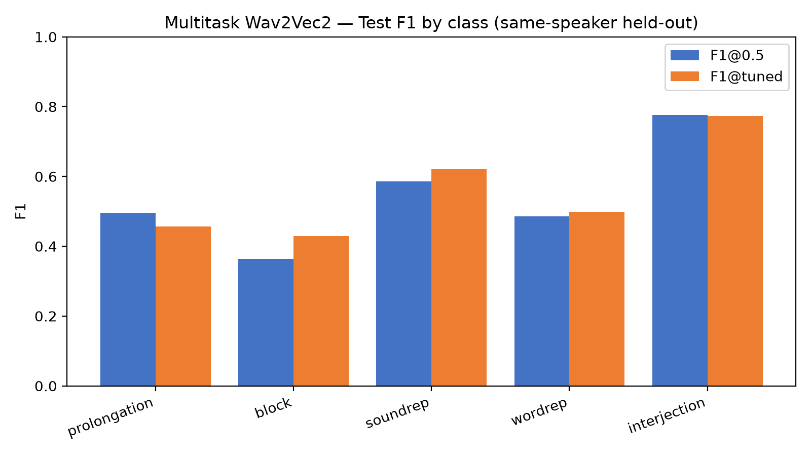
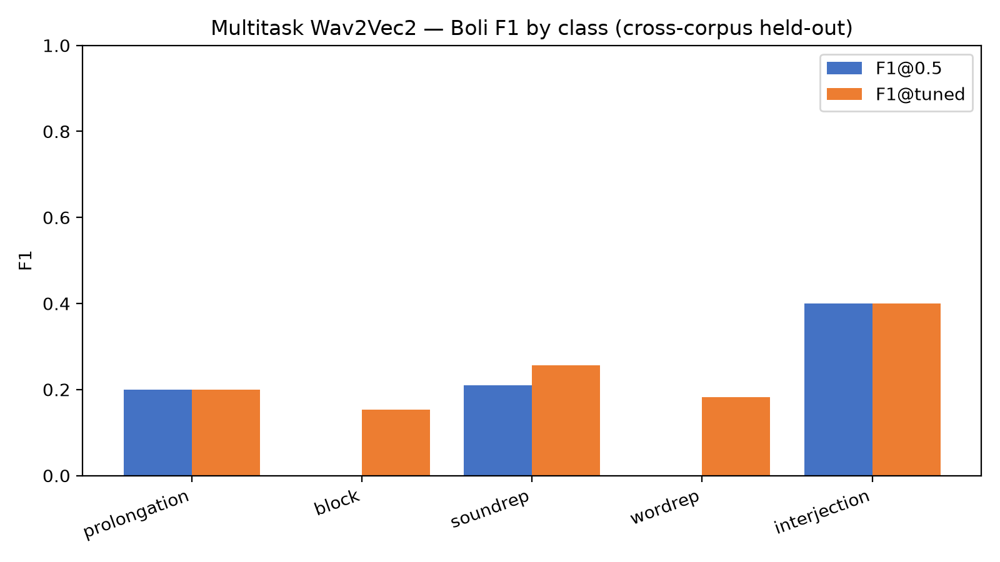
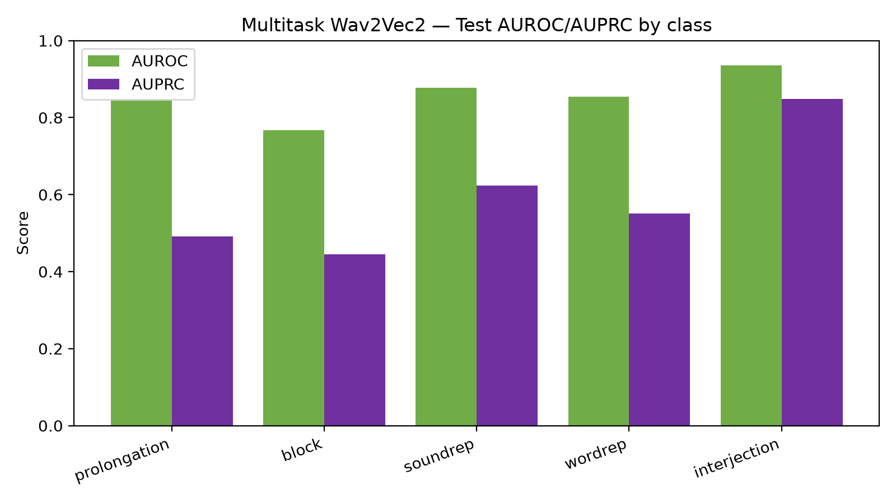
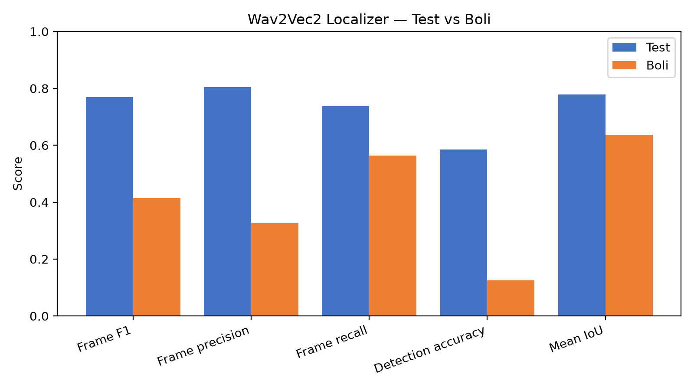

# Swaraaha — Selected Model Presentation

Selected models (best-performing):
- **Classification:** Wav2Vec2 shared backbone + 5 heads (multitask), frozen backbone 3 layers, 3 s clips.
- **Localization:** Wav2Vec2-based event localizer, 3 s clips.

Protocol: thresholds tuned on internal val only (seed 42); test = in-distribution held-out (same-speaker overlap); Boli = cross-corpus held-out.

## Classification — per-class F1 (multitask Wav2Vec2)

| Class | Test F1@0.5 | Test F1@tuned | Test AUROC | Test AUPRC | Boli F1@0.5 | Boli F1@tuned |
|---|---|---|---|---|---|---|
| prolongation | 0.495 | 0.457 | 0.845 | 0.491 | 0.200 | 0.200 |
| block | 0.364 | 0.428 | 0.767 | 0.444 | 0.000 | 0.154 |
| soundrep | 0.586 | 0.621 | 0.877 | 0.624 | 0.210 | 0.256 |
| wordrep | 0.486 | 0.499 | 0.855 | 0.550 | 0.000 | 0.182 |
| interjection | 0.776 | 0.773 | 0.935 | 0.848 | 0.400 | 0.400 |

**Macro F1:** test @0.5 = 0.5415, test @tuned = 0.5557, Boli @0.5 = 0.1621, Boli @tuned = 0.2384

## Localization — Wav2Vec2 localizer

| Metric | Test | Boli |
|---|---|---|
| Frame F1 | 0.770 | 0.414 |
| Frame precision | 0.804 | 0.328 |
| Frame recall | 0.738 | 0.564 |
| Detection accuracy | 0.586 | 0.125 |
| Mean IoU | 0.779 | 0.638 |
| False alarms/min | 4.28 | 1.90 |

## Caveats

- Test set has known same-speaker overlap (in-distribution held-out is optimistic).
- Boli is the only cross-corpus held-out set (53 clips) — numbers are noisy but honest.
- Single seed 42; thresholds tuned on val only, no test or Boli threshold fitting.
